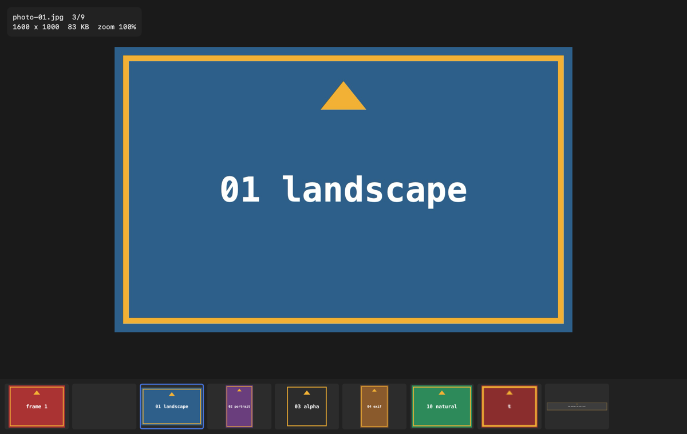
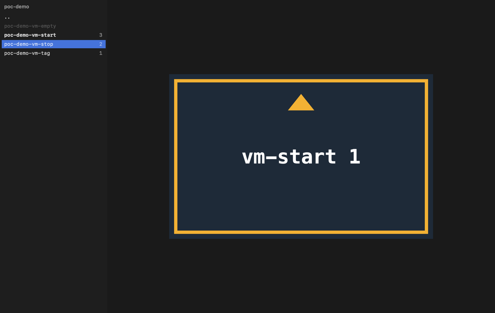
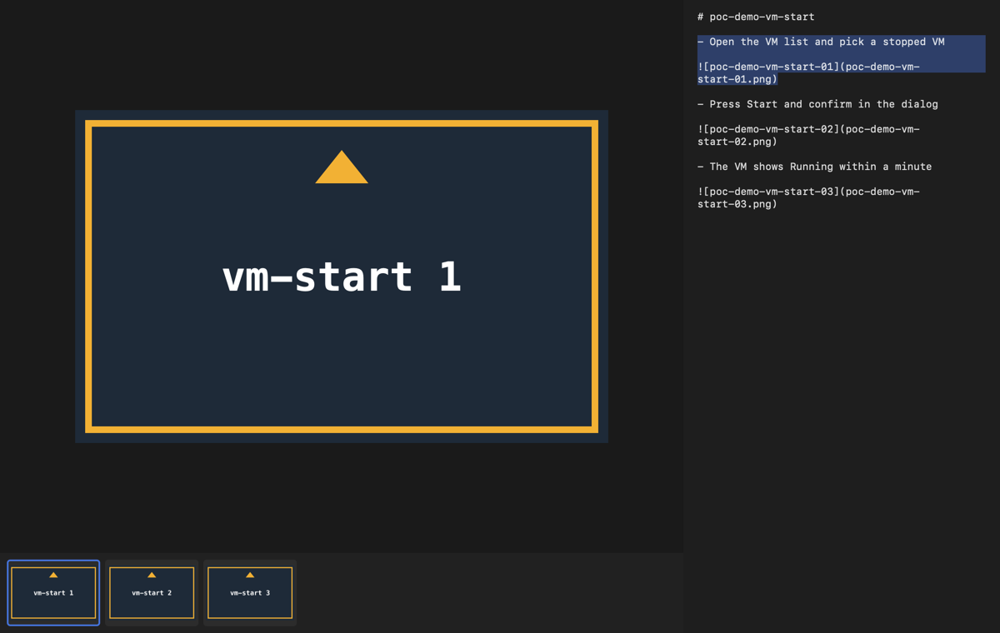
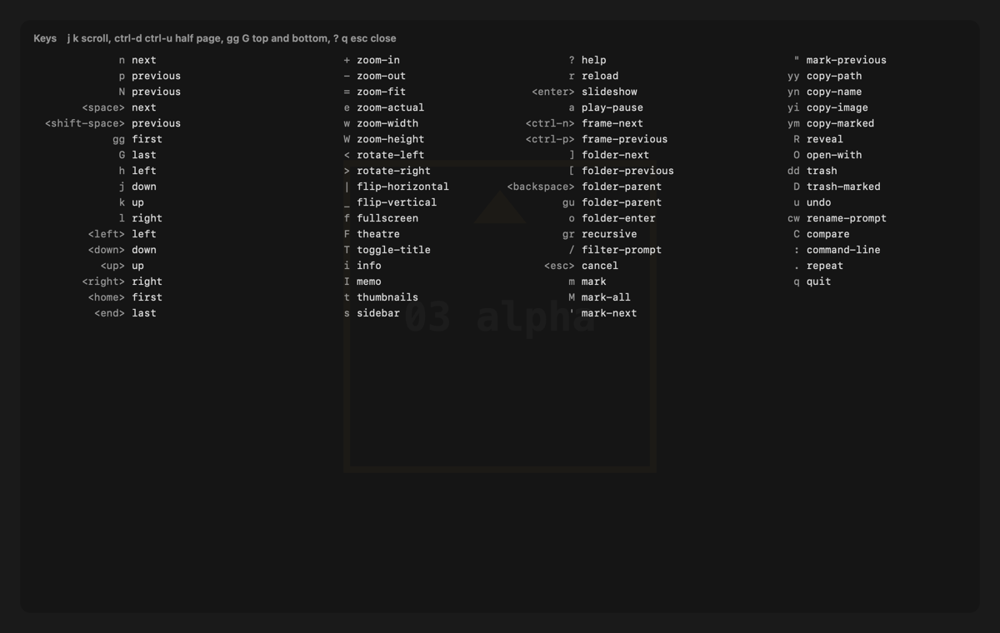

# sView


sView is a macOS-native, keyboard-first image viewer in the spirit of qView: no chrome, instant open, vim keys. It is written in Swift with an AppKit canvas and SwiftUI overlays, uses only Apple frameworks (ImageIO, Core Animation) and has no third-party dependencies. It is built for two jobs: quick-looking any photo from Finder or the terminal, and walking a tree of screenshot folders case by case without touching the mouse.



## Features

- Opens from Finder, `open -a sView`, drag and drop, the `sview` command (`ls *.png | sview -` reads paths from stdin) and File > Open Recent; a folder opens at its first image.
- Fast: decodes at window size on background threads, preloads neighbours, keeps a bounded cache, and hands Core Animation display-ready images; about 210 ms from launch to the first image and 16 ms to the next on an M-series Mac (bench/RESULTS.md).
- Everything ImageIO decodes: JPEG, PNG, HEIC, WebP, AVIF, JPEG XL, TIFF, GIF and more, with EXIF orientation; animated GIF, APNG and WebP play, pause and step frame by frame; files it cannot decode show an in-window message and Quick Look is one key away.
- Fit, width, height, actual and free zoom anchored at the cursor, pan by keys, drag or trackpad, rotate and flip for viewing, auto, colour or checkerboard backgrounds, fullscreen and a borderless theatre mode.
- Vim grammar: counts (`5n`, `20G`), multi-key bindings (`gg`, `yy`, `dd`), `.` to repeat, `/` to filter, marks, and a `:` line with tab completion for commands, options, hooks and paths.
- Folders: `]` and `[` jump between sibling folders, a sidebar of folders with image counts, a recursive mode that flattens a tree, a thumbnail strip, and a folder watch that shows new screenshots as they land.
- Files: copy path, name or image, reveal, open with, rename in place, move to trash with undo, export the marked names, compare two marked images side by side with zoom and pan in step.
- Plain-text settings and keymap in `~/.config/sview/`, reloaded the moment they change; every command is in the menu bar with its key.
- PoC evidence helpers: case id and step in the title, the case memo beside the captures with the current entry highlighted, and `:run` hooks that call your scripts with the current file, folder and marked files.





## Part of sSuite

sSuite is a small family of macOS tools that turn work done on screen into step-by-step evidence and guides, one job per tool, published under the [uSuite](https://github.com/uSuite) organization. The organization page explains why the family exists.

| Tool | Job |
| --- | --- |
| [sCapture](https://github.com/uSuite/scapture) | captures a window at a fixed size and scale into the active case folder (shell proof of concept today, Swift app next) |
| **sView** (this one) | views images and walks case folders from the keyboard |
| [sNotate](https://github.com/uSuite/snotate) | annotates a case folder as one story and exports one image per step |
| sWalk | planned: renders a notated case as an animated step-by-step clip |
| [scommon](https://github.com/uSuite/scommon) | the Swift package the tools share: folders, sorting, config and keymap |

sView is the reading link: it opens what sCapture writes, steps from one case folder to the next with `]` and `[`, and shows the case memo beside the captures. It never changes a capture, and it works on its own as an everyday image viewer for any folder of photos.

## Keys

Press `?` in a window for the live list. The most used ones:

| Keys | Action |
| --- | --- |
| `n` `p`, `space` | next and previous image |
| `gg` `G`, `20G` | first, last, image 20 |
| `h` `j` `k` `l` | pan when zoomed, else navigate |
| `+` `-` `=` `e` | zoom in, out, fit, actual size |
| `<` `>` | rotate left and right |
| `]` `[` `backspace` | next, previous and parent folder |
| `t` `s` `i` `I` | thumbnails, sidebar, info, memo |
| `m` `'` `C` | mark, next marked, compare marked |
| `yy` `yi` `R` `dd` `u` | copy path, copy image, reveal, trash, undo |
| `/` `:` `?` | filter, command line, help |

The full list is [docs/keys.md](docs/keys.md), generated from the built-in keymap.



## Settings

`~/.config/sview/config` holds one `key value` per line and documents itself; `:set <key> <value>` edits it in place. `~/.config/sview/keymap` adds or replaces bindings, one `<keys> <command>` per line, and `<keys> nop` removes a default; `:map` appends to it. `$XDG_CONFIG_HOME` is honoured. sView > Settings… (`cmd-,`) shows every option as a control and writes the same lines, and imports or exports the config and keymap as a zip.

```
preload 2
cache_mb 512
sort name
background checker
click_navigates true
hook evidence python3 ../report.py --dry-run
```

## Install

Requires macOS 26 or newer. Until a signed release is published, build it from source with Xcode 26 or newer and XcodeGen (`brew install xcodegen`):

```bash
make app
```

```bash
make install
```

SwiftPM fetches scommon from GitHub on the first build, or uses a `../scommon` checkout beside this one when there is one. `make app` writes `build/sView.app`; `make install` links the `sview` command into `~/.local/bin`. `make release` builds a universal app and zip, and `make notarize` signs and notarises it when a Developer ID is available.

## Development

`make test` runs the core library tests, `make smoke` drives the app through every default key binding and takes snapshots, `make hostile` throws broken and huge files at it, `make idle` checks idle CPU and leaks, and `make bench` appends a line to bench/RESULTS.md. The architecture is in docs/02-tech-stack.md, the backlog in docs/01-backlog.md and decisions in docs/DECISIONS.md. Branches follow git-flow and versions follow semver; the version lives in `VERSION`.

## Licence

MIT, see `LICENSE`.
